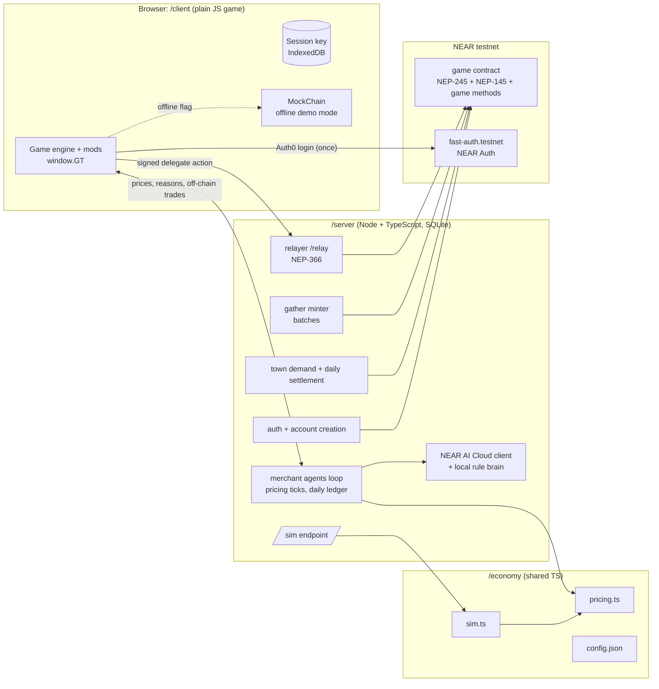

# Architecture

Status: design (M0), updated 2026-11-01. Gathering, farming, crafting and merchant trades are now off-chain with a
daily on-chain settlement; see [onchain-offchain.md](onchain-offchain.md). The checks that were open at M0 are resolved in [sources.md](sources.md#open-checks-from-m0-resolved-in-m1-2026-10-31).

## Overview

## Folders

| Folder | What | Notes |
| --- | --- | --- |
| `/client` | The existing game, split back into `sprites.js`, `engine.js`, `mods/*.js`, plus new `mods/economy.js`, `mods/market.js`, `mods/riwayat.js`, `chain/` (real and mock chain adapters) | Plain JS, served statically, no build step needed for offline mode |
| `/server` | Node 24 + TypeScript service, SQLite (`better-sqlite3` or Node's built-in `node:sqlite`, picked in M1) | Holds every key, reads them from env vars only |
| `/contracts/game` | Rust, `near-sdk` 5.x, built with `cargo-near` | One contract: NEP-245 multi token (with `coin`), NEP-145 storage, game methods |
| `/economy` | `config.json`, `pricing.ts`, `sim.ts`, `items.ts` | Imported by both server and simulator, and bundled for the browser chart view |
| `/docs` | Design docs, threat model, sources, simulation reports | |
| `/prototype` | The unchanged baseline (tag `pre-hackathon`) | Reference only, not served |

One command: `docker compose up` (server + static client) with a `.env` copied from `.env.example`. A plain
`npm run dev` will also work without Docker.

## Accounts on testnet

All are sub-accounts of one top-level account created for this project, named below as `genesistown.testnet`. The
exact name will be picked when it is created in M1.

| Account | Holds | Keys on the server |
| --- | --- | --- |
| `genesistown.testnet` | contract owner, config changes | **none**: its full-access key stays off the server (`near-cli-rs` keychain on the dev machine) |
| `game.genesistown.testnet` | the contract | none after deploy |
| `relayer.genesistown.testnet` | NEAR for gas | full-access keys (the reference relayer requires them), rate limited and spend monitored |
| `minter.genesistown.testnet` | nothing; the contract only trusts it to mint gathered items | function-call key → `game` only |
| `town.genesistown.testnet` | treasury coins, initial merchant shares | function-call key → `game` only |
| `sari.…`, `budi.…`, `wati.…`, `joko.…` | merchant balances inside the contract | function-call key → `game` only; balances change through the daily settlement (no quote key needed any more) |
| `players.genesistown.testnet` | parent of player accounts, a small NEAR float for account creation | full-access key (account creation needs one), only small balances kept |
| `<id>.players.genesistown.testnet` | a player | the server keeps **no** key for players |

## Sign-in with no seed phrase and no gameplay popups

NEAR Auth signs with an MPC-derived key, but **every** NEAR Auth signature goes through Auth0 (a popup or redirect),
per the docs. So it is used for login and account ownership only, and gameplay is signed by a scoped session key.

1. **Login (the only popup).** `@fast-auth-near/browser-sdk` + `@fast-auth-near/javascript-provider`, network
   `testnet`, with the shared testnet client id and contracts `fast-auth.testnet` / `v1.signer-prod.testnet` from the
   NEAR Auth testnet page. The client reads the player's MPC-derived public key.
2. **Session key.** The browser generates an ed25519 key pair. M1 keeps it in localStorage; M4 hardens it to a
   non-extractable WebCrypto key.
3. **Register.** `POST /auth/register {idToken, sessionPublicKey}`. The server:
   - verifies the Auth0 id token against the tenant's JWKS;
   - takes `sub` and derives the player's NEAR Auth key itself by calling `derived_public_key` on
     `v1.signer-prod.testnet` (path `jwt#https://login.testnet.fast-auth.com/#`, predecessor
     `fast-auth.testnet`, domain 1), so the browser cannot claim someone else's key;
   - then creates
   `<id>.players.genesistown.testnet` in one transaction with:
   - the MPC-derived key as a **full-access** key, so the player owns the account and can revoke anything;
   - the session key as a **function-call key** limited to `game.genesistown.testnet` and the game method list.

   The server then registers storage for the player in the contract and sends the starter kit from the treasury.
4. **Play.** For each action the client builds a `DelegateAction` (receiver = game contract, one `FunctionCall`,
   deposit 0), signs it with the session key, and posts it to `/relay`. The relayer checks it, wraps it in a
   NEP-366 `SignedDelegate` and pays the gas. The meta-transaction docs confirm that function-call keys can sign
   delegate actions; the key's allowance is not checked because the relayer pays.
5. **Lost browser or new device.** Log in again with Auth0. The server adds a new session key only after one NEAR
   Auth signature (one Auth0 approval) from the account's full-access key. That is the only other popup, and it is
   rare.

**Consequence for NEP-245.** Standard `mt_transfer` requires exactly 1 yoctoNEAR attached, and function-call keys
cannot attach deposits. Gameplay therefore uses game methods (`sell_to_merchant`, `buy_listing`, `craft`, …) that
take no deposit and carry their own limits. The standard NEP-245 methods stay spec-compliant for real wallets. This
trade-off is analysed in [threat-model.md](threat-model.md).

## Trades with merchants: off-chain, settled daily

Merchants are game NPCs that each own a real testnet account. Their trades with players happen off-chain at
`pricing.ts` prices, as entries in the day's ledger (see [onchain-offchain.md](onchain-offchain.md)). At 06:00 the
settlement moves each merchant's and each player's net change of items and `coin` on chain in one batch. Merchant
balances, cash and stock are therefore real on-chain state, updated once per game day.

This replaces the M0 design of one atomic on-chain call per trade with merchant-signed quotes. Quotes were only
needed because each trade was a transaction; with daily settlement they add cost without adding trust.

## Session keys

Session keys are created as function-call keys for the game contract with an **empty method list**, which NEAR
treats as "any method on this contract". The relayer allowlist and the contract decide what a player may do:
- admin and role methods check the caller;
- `mt_transfer*` needs 1 yoctoNEAR, which a function-call key cannot attach.

New player actions in later milestones therefore work without re-issuing keys. Accounts created in M1 have
`send_item` only and need a new session key: one NEAR Auth approval, or a new test account.

## What each server role may do on chain

| Role | Methods it can call (enforced by the contract and the function-call key) | Hard limits in the contract |
| --- | --- | --- |
| settler (the M1 `minter` account) | `settle_day(day, chunk, entries, ledger_root)`, `register_player` | each `(day, chunk)` applied once; per-account per-item daily gain cap; `coin` minted only inside the faucet `W_day` and money cap; spending needs settled balance |
| town | `pay_dividends(day)`, `grant_starter(player)` | once per day; starter grants from treasury coins only |
| merchant | none of its own in the daily loop; its balances change through settlement | daily coin-out cap per merchant, enforced in settlement |
| relayer | none of its own. It only wraps delegate actions whose receiver is the game contract and whose method is on the allowlist | per-account and per-IP rate limits, gas cap per action, daily NEAR spend alarm |
| owner | `set_config`, `register_merchant`, `set_roles`, `pause` | key not on the server |
| voucher key (v5 contract only; not used by the game now) | signed `buy_island` and `save_island` vouchers for the removed broker islands | each voucher binds one account, expires in 10 minutes, and works once per island id or version ([threat-model.md](threat-model.md)) |

## Riwayat (history) panel

Every chain call made for a player returns a transaction hash. The server stores
`{account, kind, summary, tx_hash, status, created_at}` in SQLite, and the client lists them with a link to the
testnet explorer at `https://testnet.nearblocks.io/txns/<hash>` (the pattern used in the NEAR docs). Off-chain actions show as "menunggu settlement" (waiting for settlement) and are grouped under the day's settlement
transaction once it lands. Player-to-player actions get their own link immediately.

## NEAR AI Cloud and the local brain

Built in M3 (`server/src/dialogue.ts`, route `POST /api/talk`, the **Ngobrol** button in each shop):
- The server calls the OpenAI-compatible chat API at `https://cloud-api.near.ai/v1` (from the `near-ai-cloud` skill)
  with `NEARAI_API_KEY` from env. The model id comes from `NEARAI_MODEL`, or else the first entry of the provider's
  `GET /v1/models` list at startup (logged). No model id is hard-coded.
- The system prompt holds the merchant's persona and the shop's real facts from `pricing.ts`: stock vs target, bid,
  ask and the one-sentence reason for each item, cash, rent, open or closed. **Prices and reasons never come from the
  LLM**; the model only phrases them. Its reply is display-only: it can't trigger a trade or a chain action.
- With no key, or on any error or timeout (8 s), the server answers with a local line built from the same facts
  (the item the player named, or the biggest price move). No key ever reaches the browser.
- The response includes the provider's chat id, so a reply can later be checked against NEAR AI Cloud's signature
  endpoint (`/v1/signature/{chat_id}`); the client doesn't verify it yet.
- Haggling lines and souled-NPC chat through NEAR AI are not built; the prototype's NPC brain stays local.

## The shared map

The village is generated from one world seed by `client/js/world/village.js`, a plain script the browser loads and
the server imports, so both have the same map. The server uses it to check gathering and to open areas when town
projects finish on chain. Details: [world.md](world.md).
Each player's Homeland is a separate 48 x 48 map from `client/js/world/homeland.js`; every request names its world (`public` or
`HL-<n>`) and the server checks positions against that world's map ([world.md](world.md#homeland)).

## Demo and offline mode

Open `?mode=offline` (or the server can't be reached): the client swaps the real chain adapter for `MockChain`. It
keeps balances in memory with the same interface and runs `pricing.ts` in the browser. A permanent banner reads
"OFFLINE DEMO: tidak ada transaksi on-chain". Riwayat entries show "mock", with no explorer link.

## Fast-forward

`server/src/game/sim.ts` runs the real game code (same `pricing.ts`, same config, an in-memory database and the mock
chain) with N simulated players for D days, deterministic from a seed. It runs in a worker thread behind the
**Simulasi** button (`POST /api/sim`) or as a CLI for the 30-day report (`server/scripts/sim-report.ts`). It is labelled
"Simulasi (off-chain)". Charts: price per item, cash per merchant, total money supply, open/closed shops.

## Feature flags (default off in the submission build)

`casino`, `combat`, `thief`, `police`, `curfew`, `gossip`, and the claude.ai-only `social` online mode. The code stays,
and the flags are set in `client/flags.js` and the Dev panel. Player-to-player gifts and trades are replaced by the
on-chain player market.

## 3D view (optional renderer)

The game logic stays on a tile grid in `engine.js`; the 2D canvas renderer is the default. `?view=3d` (or Pengaturan) loads
`vendor/three.js` and `js/r3d/*` on demand and registers a second renderer through `GT.registerRenderer('3d', ...)`. While it is
active `render()` gives it `GT.frameInfo()` (map, entities, player, game clock, darkness) instead of drawing 2D, and it supports
rooms (`interior: true`), so the whole game is shown in 3D. If WebGL2 is missing or it fails, the game falls back to 2D.

- **Data stays shared.** The village and Homeland generators run unchanged on server and client; the 3D view only reads their
  output. Tile (x, y) maps to world (x + 0.5, 0, y + 0.5); the camera is a fixed tilted orthographic camera that follows the player.
- **Islands.** `regions.js` makes region 0 the open island and one region per locked chunk; each region is a Group that floats,
  and every module mounts its meshes per region. A chunk that becomes open slides back and merges ("berlabuh").
- **Ground and props.** `GT.bakeFlat` bakes the 2D ground without sprites that have 3D versions; trees, rocks, fences, lamps,
  stalls, buildings and the portal are procedural low-poly meshes merged per region (`geo.js` Builder).
- **People and effects.** `rig.js` is one blocky character built from the 2D palettes; `actors.js` poses it from engine and mod
  state (`GT.charState`, `GT_FX.swinging`, `GT_FISH`, `npc.cosmetic`). `fx.js` exposes `GT.fx3d` (labels, floating text,
  particles, flashes, monsters, fishing) and mods use it only when the 3D view is on. `compat.js` keeps old 2D mod hooks
  (`onDrawGround`, `onDraw`) working through a decal plane and an affine overlay.
- **Light.** Sun and moon follow `gameMin`; lamps and windows light up at night; weather comes from the `gt-w-*` classes that
  `chain.js` sets from the server's shared weather; winter whitens roofs and foliage.
- **Quality and performance.** Rendah / Sedang / Tinggi (`localStorage gt-q3d`) set pixel ratio, shadows, lamp lights and
  particle counts. A watchdog lowers the quality after a slow first ten seconds and then offers the 2D view. `?fps` shows a counter.
